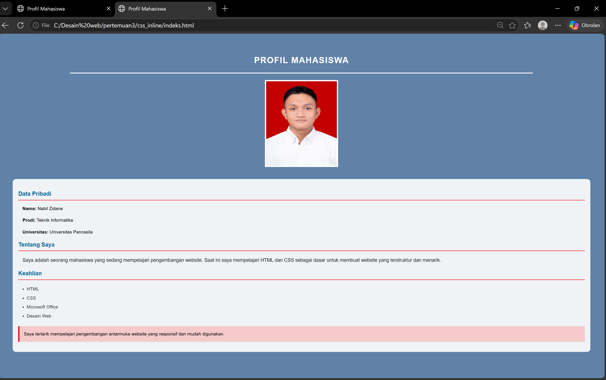
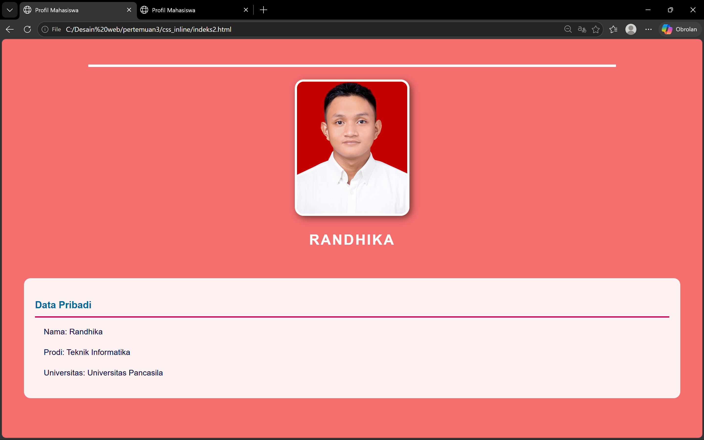
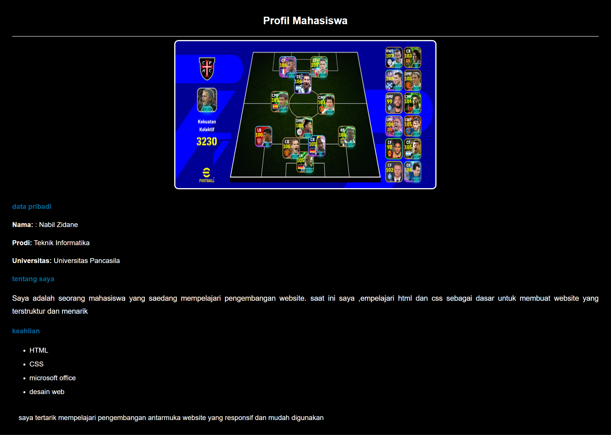

# TUGAS 3 
## ss sebelum

## ss sesudah

## Perubahan yang Dilakukan
Perubahan meliputi penggantian warna latar belakang, penambahan padding dan margin, serta pengaturan ukuran, warna, dan ketebalan teks. Foto profil diubah menjadi berukuran 250 × 300 piksel dengan border yang lebih tebal. Selain itu, bagian data mahasiswa dibuat menyerupai card menggunakan background putih transparan dan sudut melengkung. Beberapa elemen juga diberi garis bawah, bayangan, dan highlight agar tampilan lebih menarik dan mudah dibaca.

Pada file `indeks`, latar belakang diubah menjadi biru, sedangkan pada `indeks2` menjadi merah muda. Judul diperbesar dan diberi jarak antarhuruf agar lebih menonjol.

## Kendala dan Solusi
Kendala yang dihadapi adalah tampilan awal yang masih sederhana, ukuran foto yang terlalu besar, serta informasi yang kurang terstruktur. Solusinya adalah menyesuaikan properti CSS, mengatur ukuran foto, dan menambahkan elemen visual untuk memperjelas informasi.