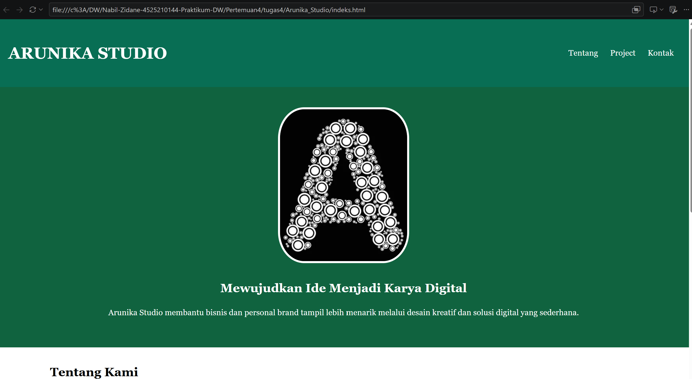
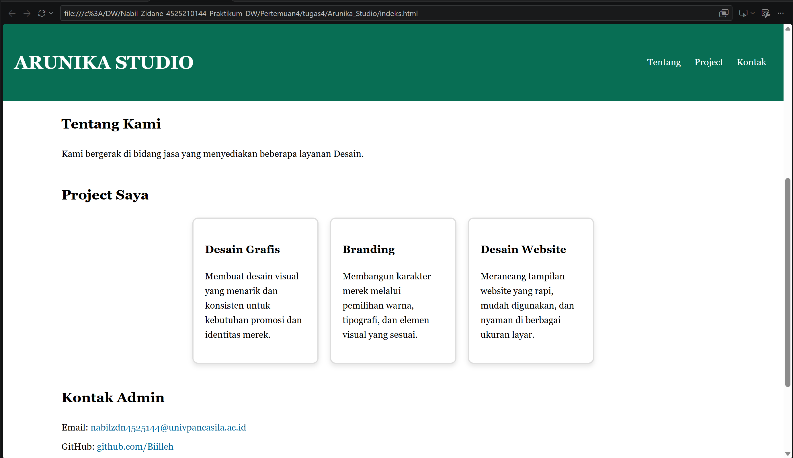
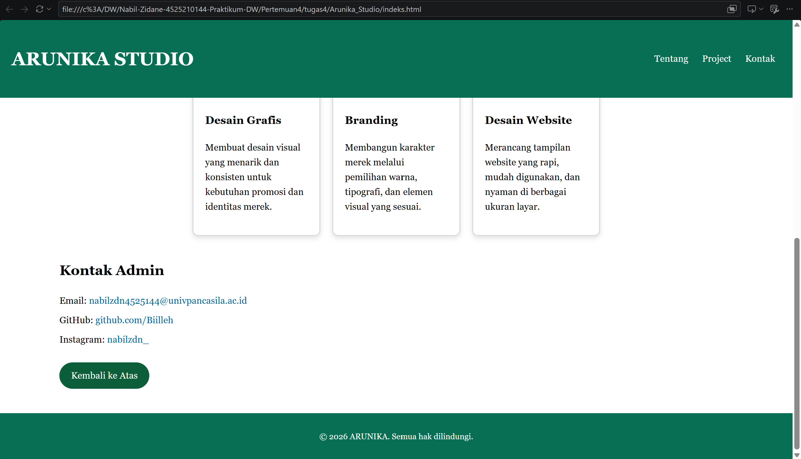

# Laporan Tugas Praktikum 

Repositori ini berisi hasil pengerjaan tugas praktikum pembuatan halaman web menggunakan HTML5 dan CSS3 eksternal.

## Masalah dan Solusi

| 1 | **Code Saya Sebelumnya Posisi Selector CSS di Luar Media Query** Aturan `.card { width: 90%; }` diletakkan di luar blok `@media`, sehingga ukuran *card* di layar komputer (*desktop*) ikut mengecil[cite: 1]. | Memindahkan aturan `.card { width: 90%; }` ke dalam kurung kurawal `@media (max-width: 768px)` agar hanya aktif pada layar kecil (*mobile*). |
| 2 | **Sebelmunnya Struktur Tag HTML Penutup Berlebih** Terdapat kelebihan tag penutup `</main>` di bagian bawah sebelum *footer*, membuat struktur elemen kurang valid[cite: 2]. | Menghapus tag `</main>` yang duplikat sehingga hierarki pembukaan dan penutupan elemen HTML menjadi rapi dan valid. |

## Penjelasan Perubahan Kode

Berikut adalah detail perubahan kode yang dilakukan untuk memenuhi seluruh kriteria soal tugas:

 **Penerapan *Box Model* & *Reusable Class*:**
  Menggunakan class `.card` secara berulang untuk 3 elemen *project* yang berbeda di dalam file HTML[cite: 2]. Pada file CSS, *box model* diterapkan menggunakan properti `padding`, `border`, `border-radius`, dan `box-sizing: border-box` agar lebar elemen terhitung dengan akurat[cite: 1].
**Desain Responsif (*Media Query*):**
  Menambahkan aturan `@media (max-width: 768px)` pada CSS[cite: 1]. Ketika ukuran layar perangkat mengecil di bawah 768px (seperti tablet atau *smartphone*), tata letak *card* yang awalnya berderet horizontal otomatis berubah menjadi vertikal 1 kolom (`flex-direction: column`) dengan lebar 90%[cite: 1, 3].
 **Elemen Semantik HTML5:**
  Menggunakan tag semantik standar seperti `<header>`, `<nav>`, `<section>`, `<main>`, dan `<footer>` untuk mengorganisasi konten halaman web agar lebih terstruktur dan mudah dibaca oleh mesin pencari maupun peramban[cite: 2].

  ## ssrun
  
  
  