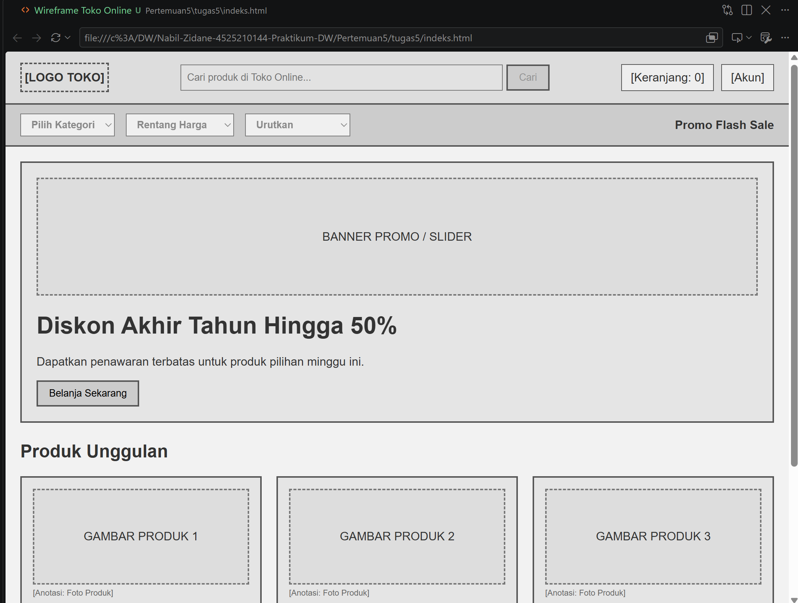
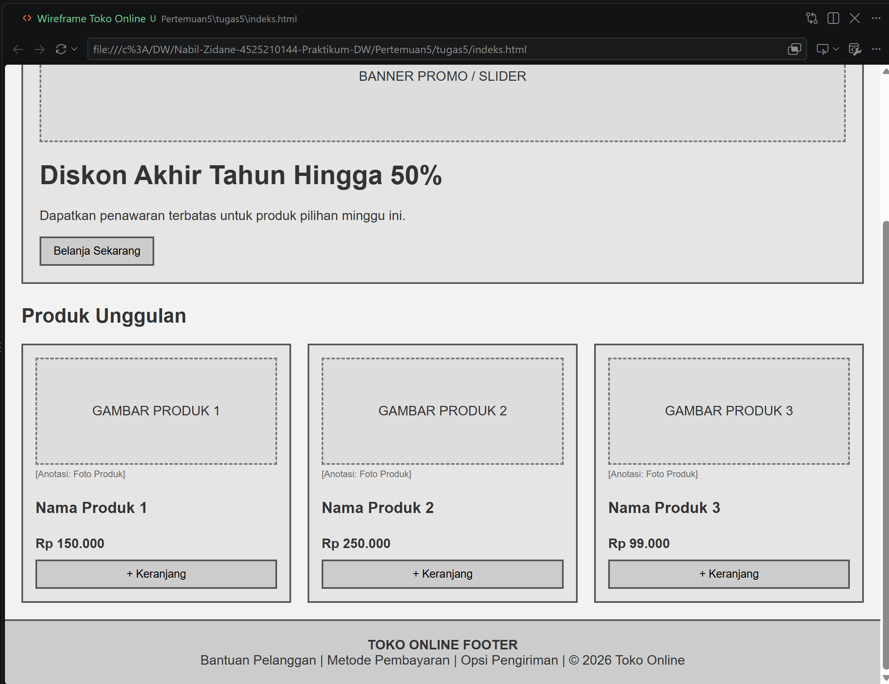
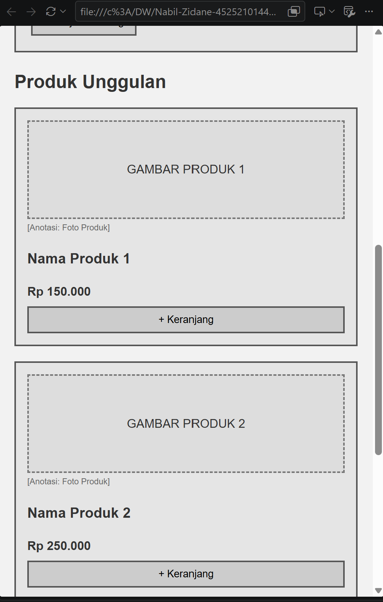
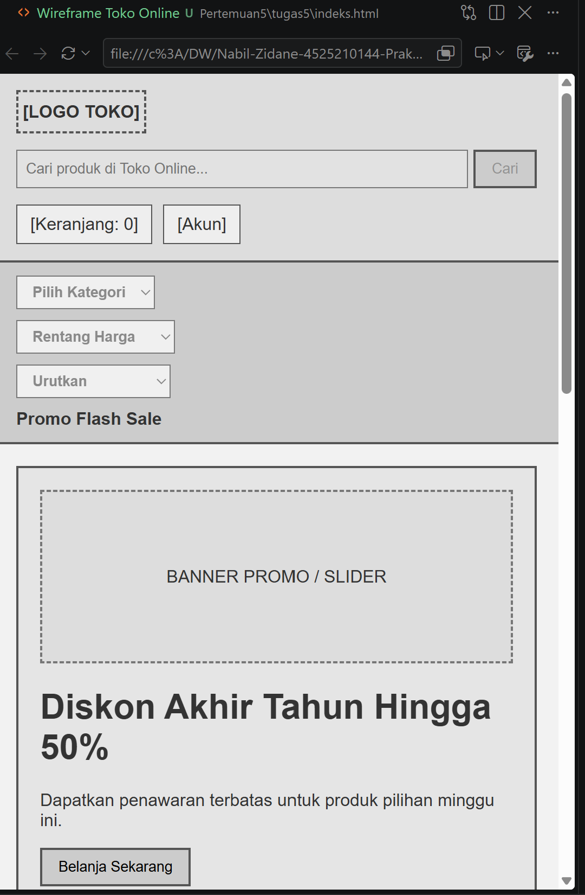
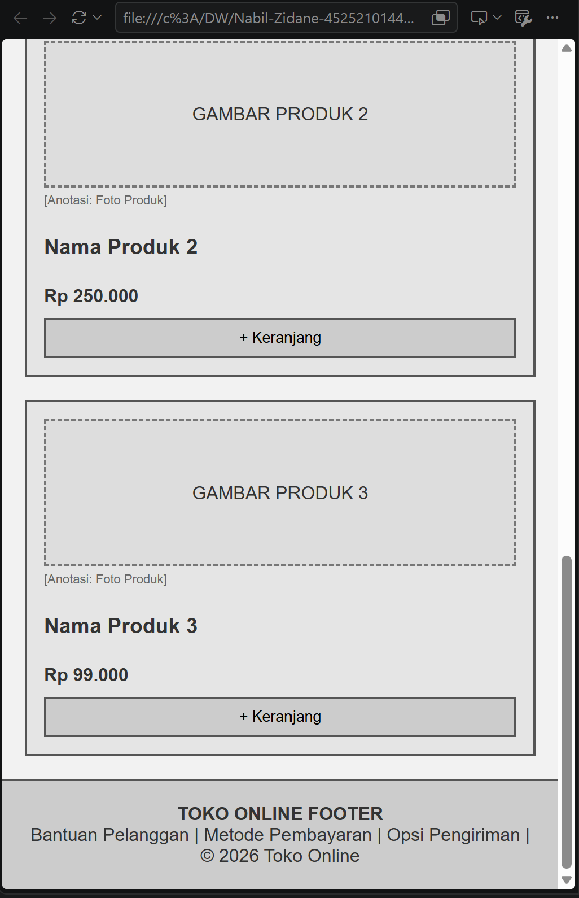

# Laporan Tugas Praktikum Desain Web: Wireframe Low-Fidelity (Toko Online)

## Studi Kasus & Masalah
Dalam studi kasus ini, saya memilih **Toko Online** sebagai masalah yang akan diselesaikan. Sebelum melangkah ke tahap coding dan *high-fidelity*, klien menginginkan perubahan susunan konten agar katalog produk lebih luas dan tidak sempit saat diakses di perangkat mobile. Oleh karena itu, *sidebar* navigasi dihapus dan seluruh kontrol penyaringan (kategori, harga, urutan) dipindahkan ke dalam *navbar* horizontal menggunakan menu *dropdown*. Perubahan ini disepakati dengan biaya rendah melalui pembuatan wireframe responsif (desktop & mobile).

## Anotasi Fungsi Area Wireframe
- **Header**: Tempat logo toko, kolom pencarian produk (*search bar*), serta akses cepat ke keranjang belanja dan akun pengguna.
- **Navbar**: Menu navigasi horizontal yang memuat filter *dropdown* (Kategori, Rentang Harga, Urutan) dan tautan promo *Flash Sale*.
- **Hero Banner**: Ruang spanduk promosi utama dengan *image placeholder* ukuran besar dan tombol aksi (*Call to Action*).
- **Grid Katalog Produk**: Daftar kartu produk unggulan (*product card*) berisi foto produk, nama, harga, dan tombol `+ Keranjang`.
- **Footer**: Bagian penutup berisi informasi bantuan pelanggan, metode pembayaran, opsi pengiriman, serta hak cipta toko.

## Ringkasan Perubahan, Masalah, dan Solusi 
Pada perancangan wireframe toko online ini, terjadi iterasi struktur akibat perubahan kebutuhan klien sebelum tahap *high fidelity*. Permasalahan utama yang muncul pada rancangan awal adalah penggunaan *sidebar* navigasi yang memakan banyak ruang horizontal, sehingga katalog produk terasa sempit dan kurang fleksibel saat diakses di perangkat *mobile*. Klien menginginkan fokus utama halaman pada produk serta akses penyaringan barang yang ringkas tanpa mengurangi area visual katalog.

Sebagai solusinya, dilakukan restrukturisasi dengan menghapus *sidebar* secara penuh dan memindahkan seluruh kontrol penyaringan (kategori, rentang harga, dan pengurutan) ke dalam *navigation bar* di bawah *header* menggunakan menu *dropdown*. Pada tampilan *desktop*, menu filter tersusun rapi secara horizontal. Sedangkan pada tampilan *mobile*, *navbar* berubah fleksibel secara vertikal (*stacking*) sehingga tetap ramah pengguna (*user-friendly*). Penyesuaian ini meminimalkan biaya perbaikan kode di kemudian hari, mempercepat alur transaksi pengguna (*user journey*), dan memastikan kesepakatan struktur antarmuka antara tim pengembang dan klien telah tercapai sebelum melangkah ke pembuatan desain *high fidelity*.

## SS hasil
### -desktop-

### -mobile-

