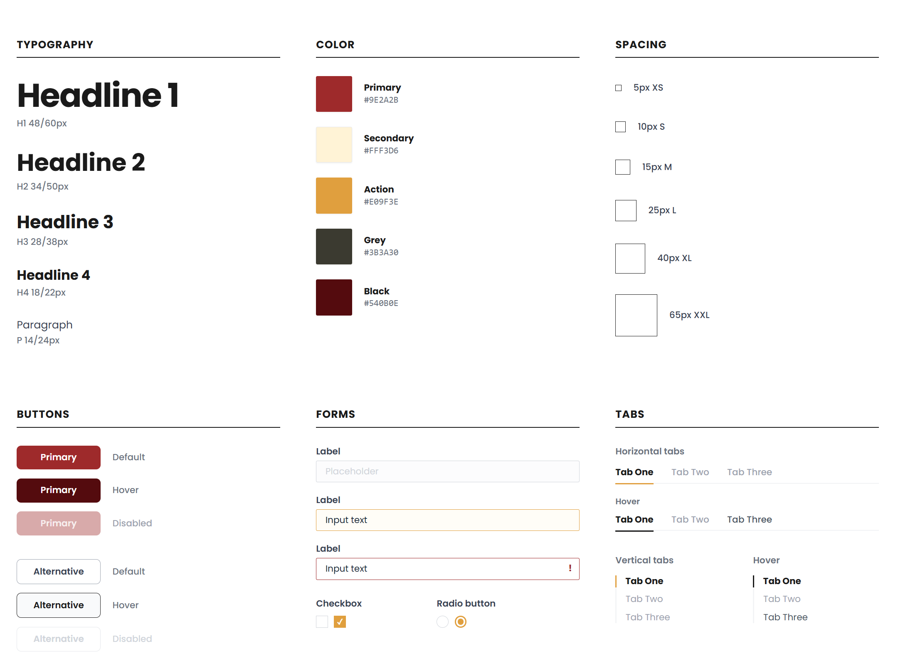
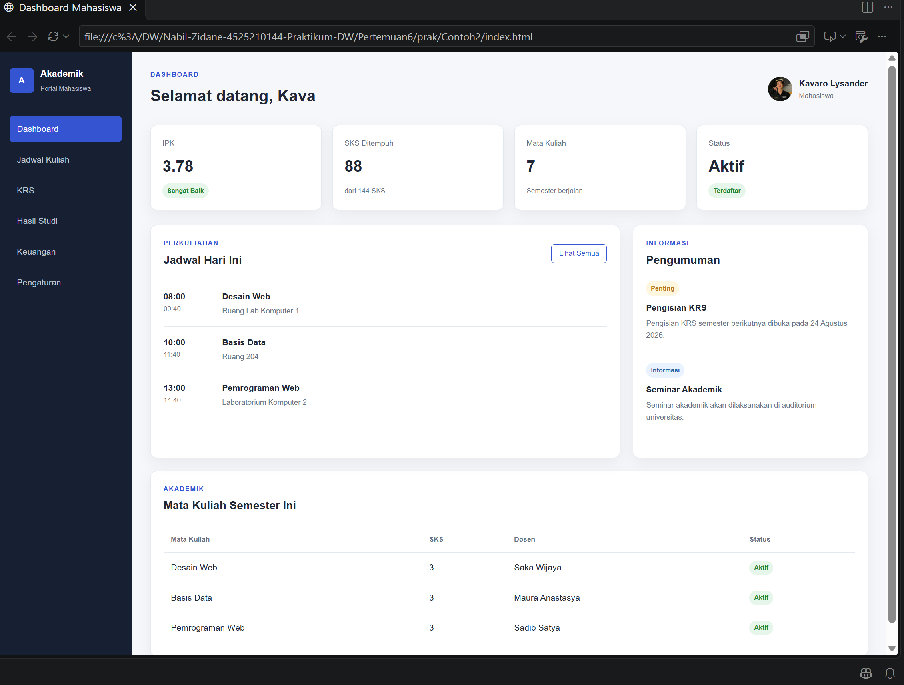
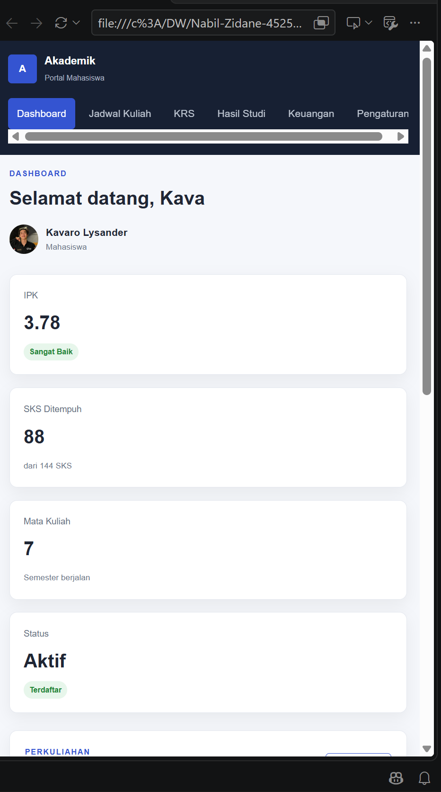
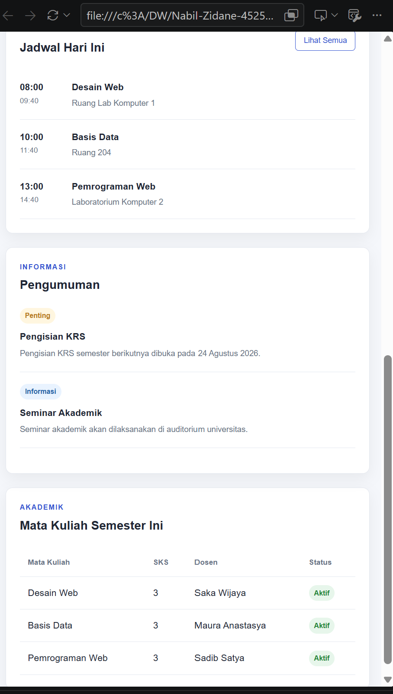
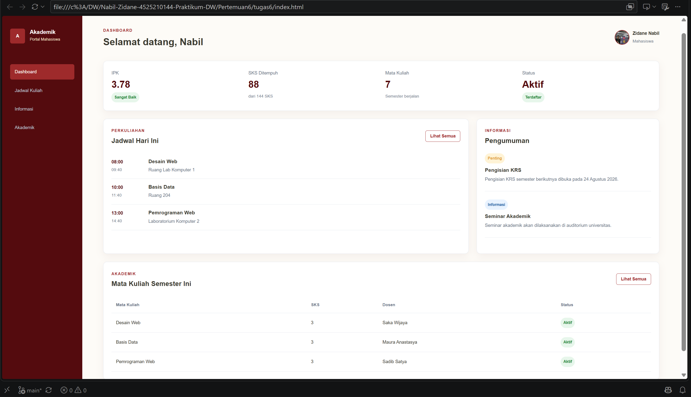
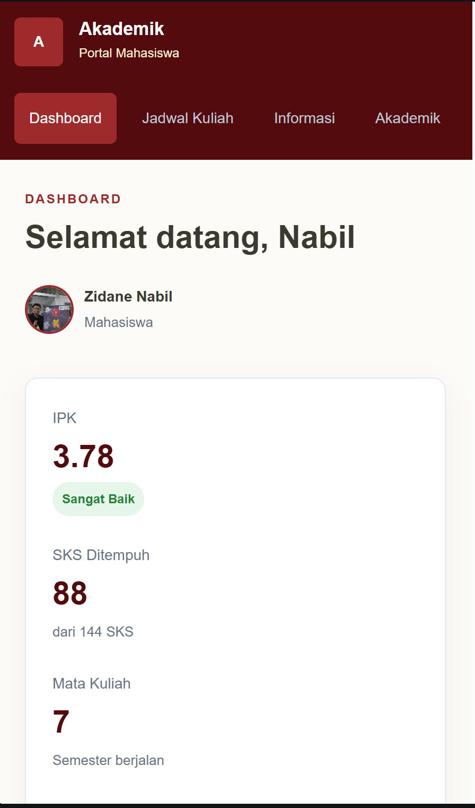
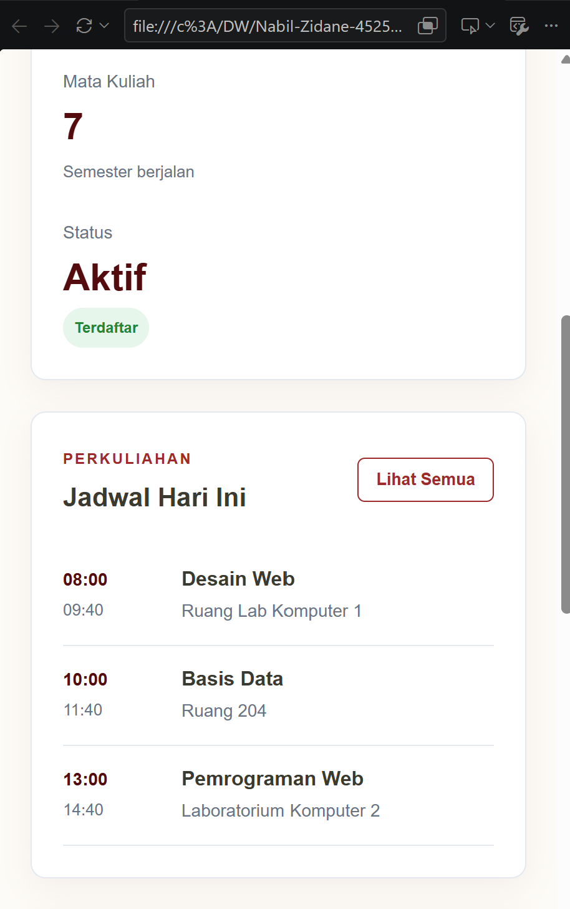
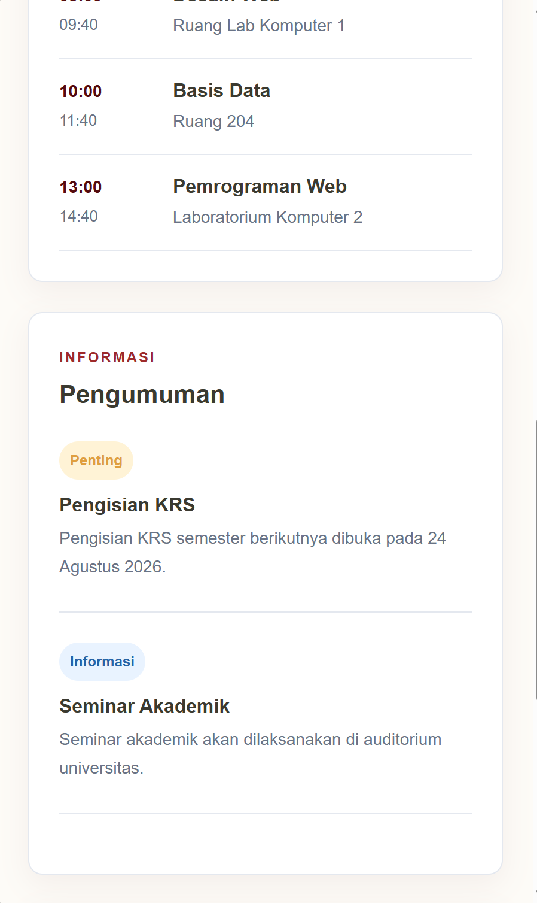
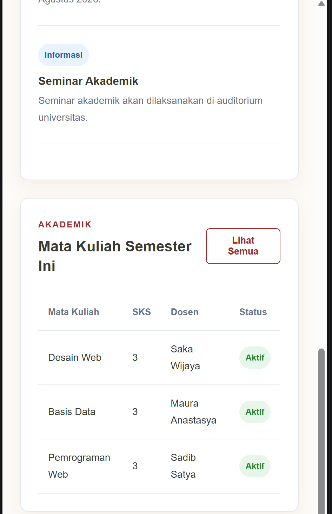

# Laporan Tugas Praktikum Desain Web: Dashboard Akademik Mahasiswa

## Studi Kasus & Masalah
Dalam studi kasus ini, saya mengembangkan antarmuka antarmuka pengguna berupa **Dashboard Akademik Mahasiswa**. Permasalahan utama pada desain awal antarmuka ini terletak pada navigasi *sidebar* yang belum sinkron dengan struktur konten halaman, ketiadaan tautan navigasi langsung ke area (*anchor linkage*), susunan panel statistik yang memakan ruang secara acak/vertikal, serta konsistensi fitur aksi pada bagian tabel data akademik. 

Untuk menyelesaikan masalah tersebut, dilakukan restrukturisasi komponen antarmuka agar mendukung navigasi internal (*smooth scroll*), pengelompokan indikator statistik menjadi satu panel horizontal yang ringkas, serta penyelarasan tombol aksi di setiap modul utama.

## Anotasi Fungsi Area Dashboard
- **Sidebar (Navigasi Utama)**: Memuat logo sistem portal, identitas institusi, dan tautan navigasi cepat menuju bagian *Dashboard*, *Jadwal Kuliah*, *Informasi*, dan *Akademik* dengan dukungan navigasi *anchor link*.
- **Topbar (Header Profil)**: Menampilkan salam pengguna, ucapan selamat datang, foto profil mahasiswa, nama lengkap, dan status peran dalam sistem.
- **Stat-Container (Panel Statistik Utama)**: Satu wadah panel terpadu (*single container*) yang menampilkan 4 indikator performa utama mahasiswa secara horizontal (IPK, SKS Ditempuh, Jumlah Mata Kuliah, dan Status Keaktifan).
- **Jadwal Hari Ini (Section Perkuliahan)**: Panel yang menampilkan daftar kelas harian beserta jam dan lokasi ruangan, dilengkapi tombol aksi `Lihat Semua`.
- **Pengumuman (Section Informasi)**: Panel samping (*aside*) untuk memberikan notifikasi penting atau informasi akademis terbaru kepada mahasiswa dengan *badge* tingkatan status (*Penting* / *Informasi*).
- **Mata Kuliah Semester Ini (Section Akademik)**: Tabel responsif memuat daftar mata kuliah yang sedang diambil, jumlah SKS, nama dosen pengampu, status mata kuliah, dan dilengkapi tombol aksi `Lihat Semua`.

## Ringkasan Perubahan, Masalah, dan Solusi 
Dalam proses pengembangan antarmuka dashboard ini, terjadi beberapa iterasi perbaikan untuk meningkatkan *User Experience* (UX) dan kerapian visual:

1. **Penyesuaian Navigasi Sidebar dan Aksesibilitas Halaman**
   - **Masalah**: Menu navigasi sidebar sebelumnya berisi item yang kurang relevan (seperti KRS, Hasil Studi, Keuangan, Pengaturan) yang belum tersedia pada struktur halaman tunggal, serta link `href="#"` yang tidak berfungsi.
   - **Solusi**: Menu sidebar disesuaikan menjadi 4 bagian utama yang ada pada halaman (`#dashboard`, `#jadwal`, `#informasi`, `#akademik`). Properti `scroll-behavior: smooth` ditambahkan pada CSS untuk memberikan efek navigasi antar-bagian yang halus saat menu diklik.

2. **Konsistensi Fitur Aksi pada Panel Utama**
   - **Masalah**: Panel "Jadwal Hari Ini" memiliki tombol `Lihat Semua`, sementara panel "Akademik (Mata Kuliah)" tidak memilikinya sehingga tampak tidak konsisten.
   - **Solusi**: Menambahkan tombol `Lihat Semua` (`.btn-outline`) pada header panel Akademik agar memiliki hierarki tata letak dan fungsionalitas visual yang sejajar.

3. **Restrukturisasi Grid Statistik Utama**
   - **Masalah**: Kartu statistik awal mulanya terpisah menjadi 4 kotak kecil terpisah. Ketika dikelompokkan ke dalam satu wadah panel, layout sempat menumpuk secara vertikal dan tidak sejajar.
   - **Solusi**: Mengubah elemen `.stat-container` menjadi layout *CSS Grid* 4 kolom horizontal (`grid-template-columns: repeat(4, 1fr)`) di dalam satu kartu panel utuh, disertai pemberian jarak (*margin-bottom*) yang presisi terhadap panel di bawahnya.

4. **Kerapian Penataan dan Responsivitas**
   - **Masalah**: Pengaturan tampilan pada layar kecil (*mobile/tablet*) berisiko merusak struktur kolom statistik.
   - **Solusi**: Menerapkan *media queries* responsif yang mengubah grid 4 kolom menjadi 2 kolom pada tablet (width < 1000px) dan 1 kolom bertumpuk (*stacking*) pada mobile (width < 700px).

## desain sistem

## SS sebelum
### - Desktop -

### - Mobile -

## SS sesudah
### - Desktop -

### - Mobile -

