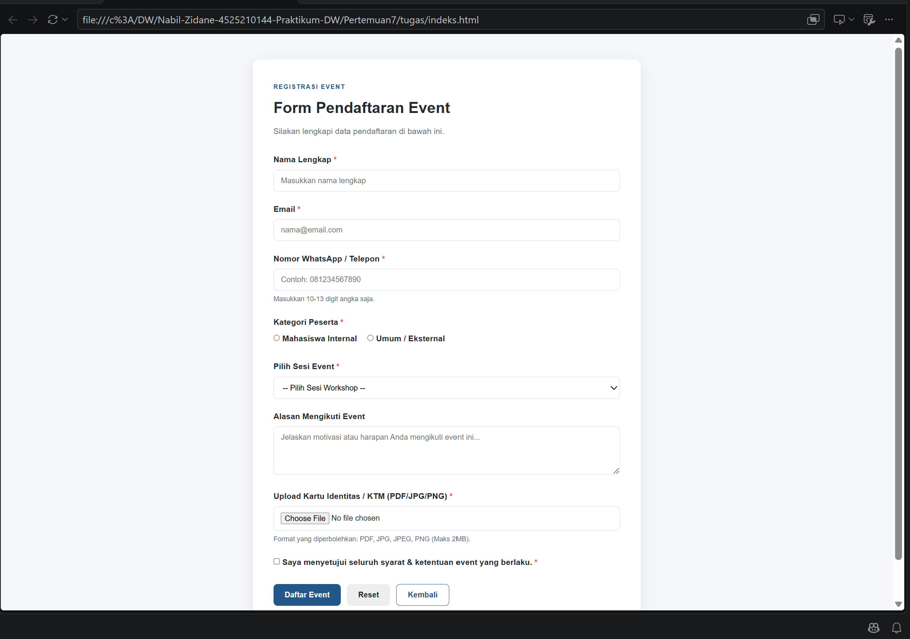
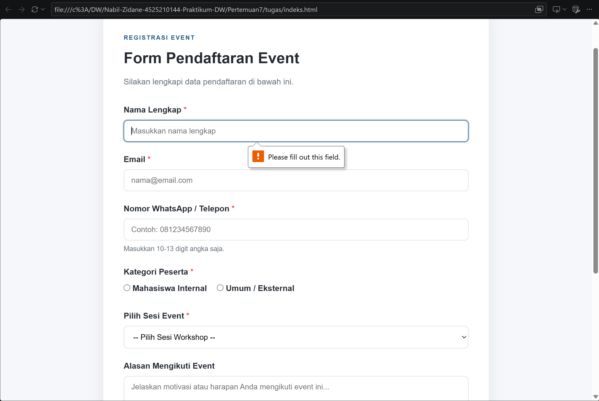
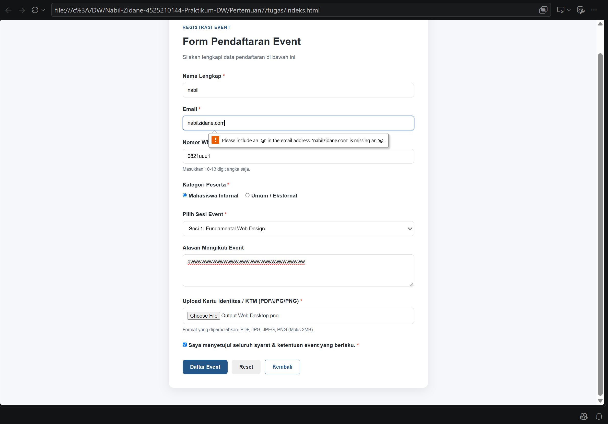
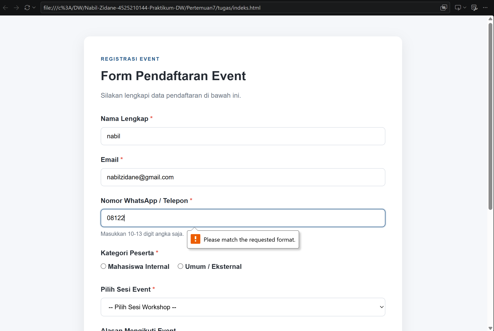
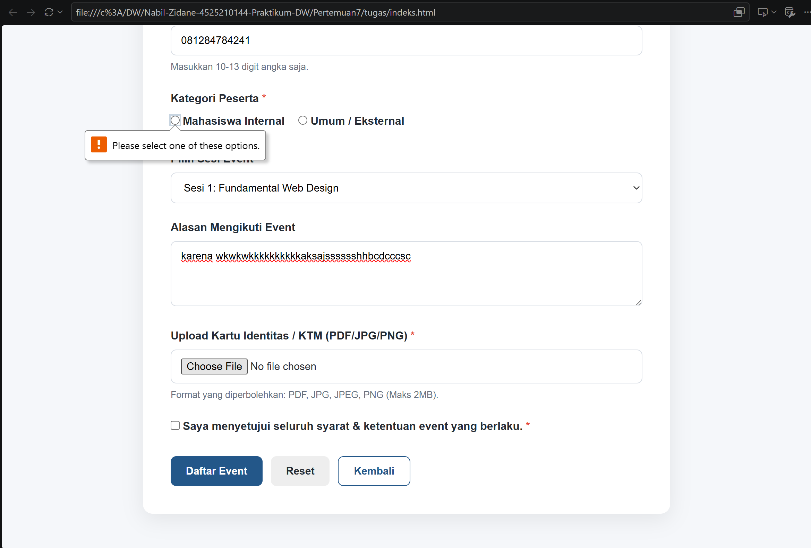
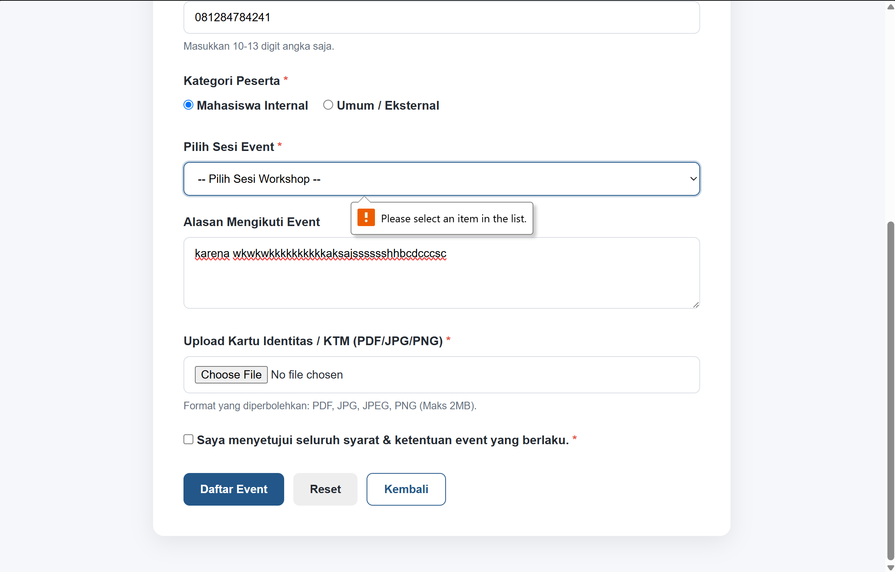
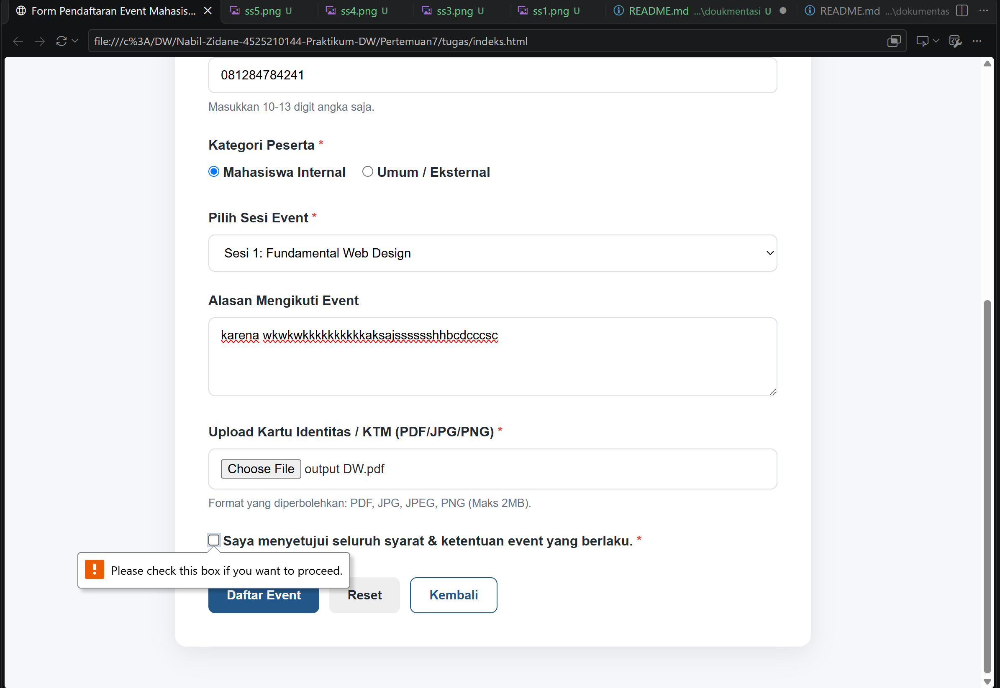

# Laporan Tugas Praktikum Desain Web: Form Registrasi Event & Validasi

## 1. Deskripsi Studi Kasus
Pada praktikum ini, dibangun sebuah antarmuka **Form Registrasi Event Mahasiswa** yang dilengkapi dengan berbagai tipe elemen masukan HTML (seperti *input text, email, tel, radio button, select option, textarea, file upload, dan checkbox*). 

Sistem ini dirancang untuk memastikan integritas data pendaftaran sebelum dikirimkan ke server dengan menerapkan kombinasi aturan validasi HTML5 bawaan (*client-side validation*).

---

## 2. Penggunaan Komponen & Aturan Validasi HTML5
Formulir ini menggunakan elemen-elemen sesuai dengan kebutuhan praktikum:
1. **Radio Button**: Memilih tipe kategori peserta (*Mahasiswa Internal* / *Umum*).
2. **Select Option**: Memilih sesi event/workshop yang ingin diikuti.
3. **Textarea**: Mengisi alasan/motivasi keikutsertaan event.
4. **File Upload (`input type="file"`)**: Mengunggah kartu identitas / KTM.
5. **Checkbox**: Persetujuan syarat dan ketentuan event.

### Minimal 4 Aturan Validasi HTML5 yang Diterapkan:
* **Validasi 1 (`required`)**: Memastikan field penting (Nama, Email, Telepon, Kategori, Sesi, File Upload, dan Checkbox) tidak boleh dikosongkan. Field wajib ditandai dengan simbol asterisk merah (`*`).
* **Validasi 2 (`type="email"`)**: Memastikan format input email sesuai standar alamat email valid (memiliki karakter `@` dan domain).
* **Validasi 3 (`pattern` & `minlength`/`maxlength`)**: Memastikan nomor telepon/WhatsApp hanya menerima karakter angka dengan panjang 10 hingga 13 digit (`pattern="[0-9]{10,13}"`).
* **Validasi 4 (`accept`)**: Membatasi format ekstensi file yang diunggah hanya berupa `.pdf`, `.jpg`, `.jpeg`, atau `.png`.

---

## ss hasil
### awal

### salah 

