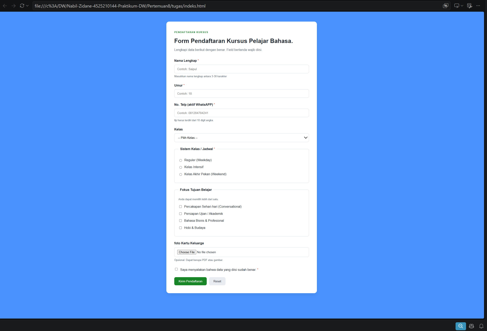
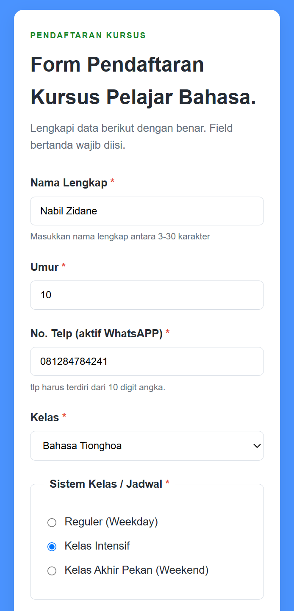
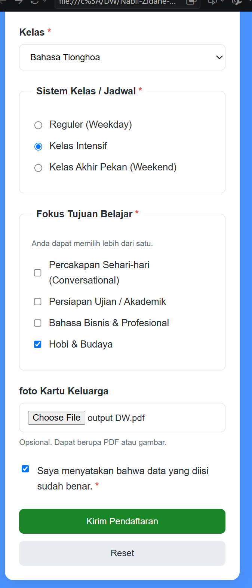
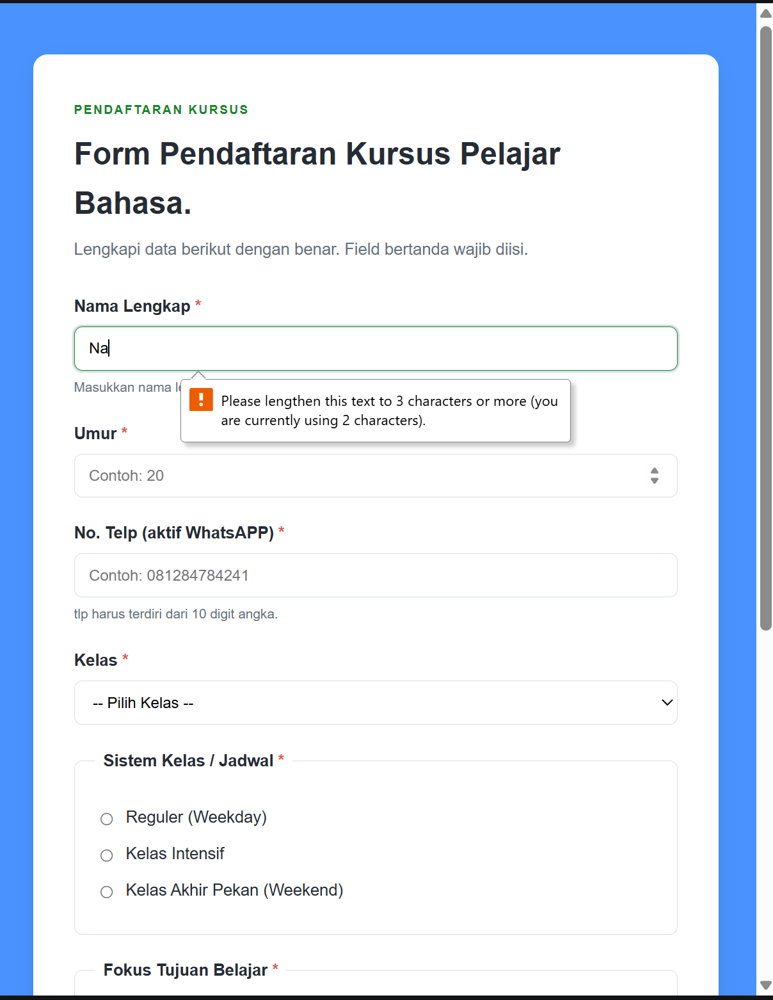
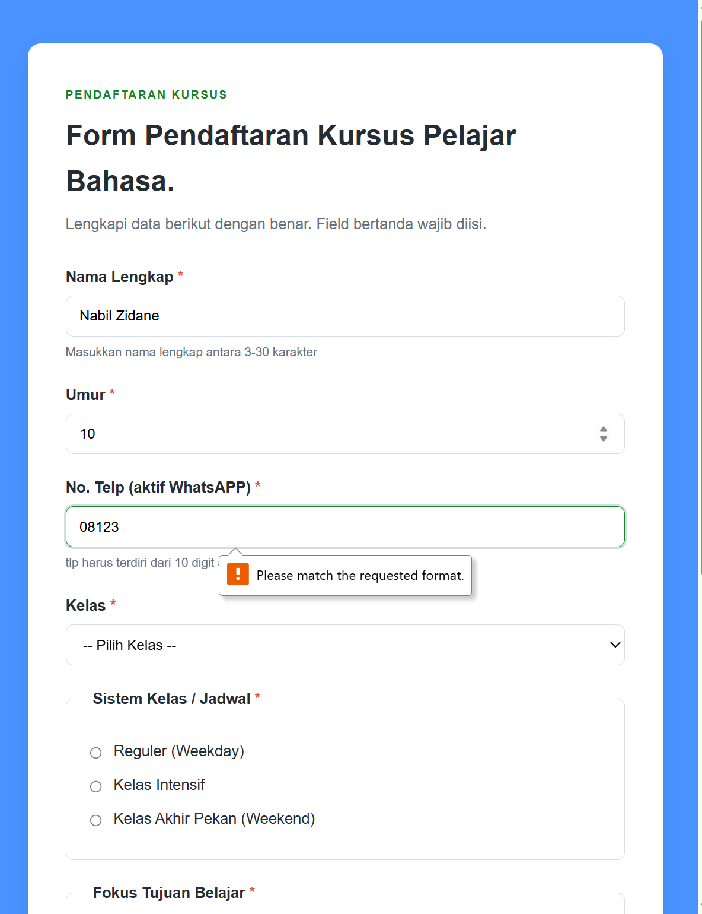
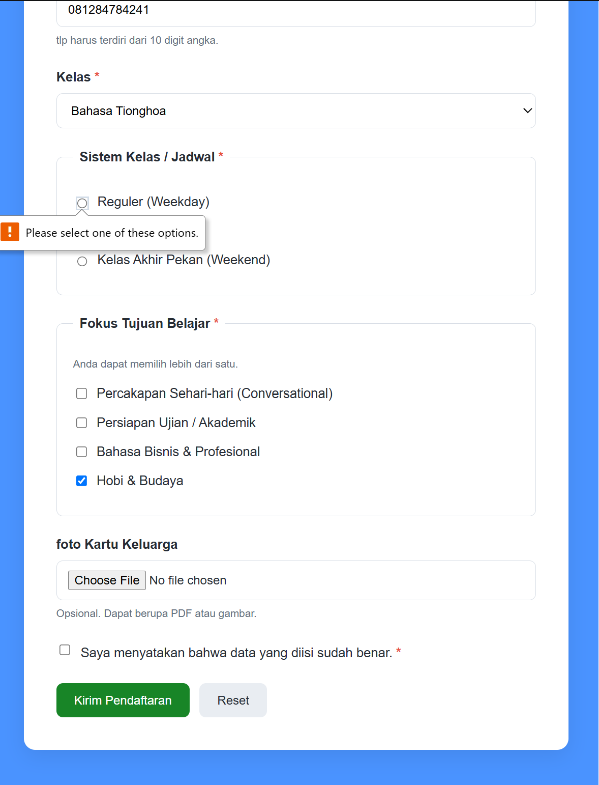
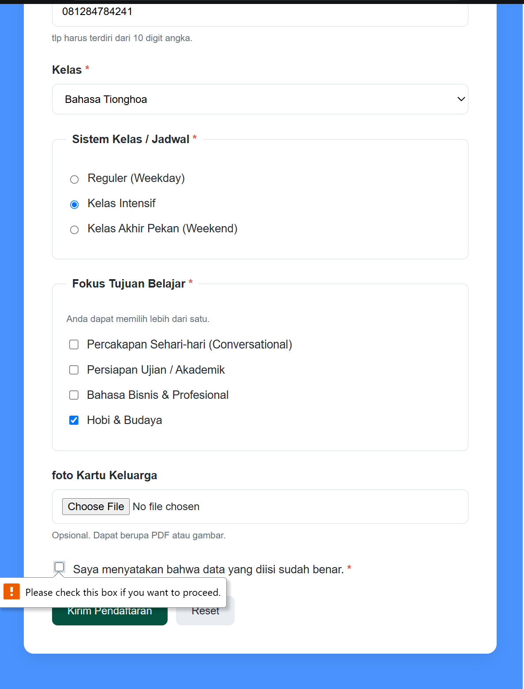

# Laporan Praktikum: Form Pendaftaran Kursus Pelajar Bahasa

## 1. Deskripsi Project & Struktur Folder

Aplikasi web ini merupakan formulir pendaftaran kursus bahasa berbasis web yang dirancang menggunakan HTML5 dan CSS3 (desain responsif).

## 2. Fitur & Komponen Element Form

Sesuai spesifikasi tugas, formulir ini menyertakan elemen-elemen berikut:
1. **Radio Button**: Pemilihan Sistem Kelas / Jadwal (Reguler, Intensif, Weekend).
2. **Checkbox**: Pemilihan Fokus Tujuan Belajar (Dapat memilih lebih dari satu) & Persetujuan syarat/ketentuan.
3. **Select**: Dropdown pilihan bahasa yang ingin dipelajari (Bahasa Indonesia, Inggris, Jepang, dll).
4. **Textarea**: (Dapat ditambahkan pada form sesuai kebutuhan catatan/pesan tambahan).
5. **Upload File**: Mengunggah berkas pendukung/bukti (*Kartu Keluarga/Bukti Pembayaran* dengan ekstensi `.pdf`, `.jpg`, `.jpeg`, `.png`).
6. **3 Jenis Button**: 
   - `submit` (Kirim Pendaftaran)
   - `reset` (Reset Form)
   - *Button tambahan/action opsional*.

---

## 3. Aturan Validasi Input (Form Validation Rules)

Pada form ini diterapkan 4 aturan validasi utama di sisi client (HTML5 Attributes):
1. **Required (`required`)**: Bidang nama, umur, nomor telepon, pilihan kelas, sistem kelas, dan checkbox persetujuan wajib diisi/dipilih.
2. **Karakter Min/Max (`minlength` / `maxlength`)**:
   - Field **Nama**: Panjang karakter minimal 3 dan maksimal 30.
   - Field **Umur**: Maksimal 2 digit angka.
3. **Pola Regex (`pattern`)**: Field **No. Telp** wajib berupa format angka 10 digit (`pattern="[0-9]{10}"`).
4. **Pembatasan Tipe File (`accept`)**: Field **Upload File** hanya menerima ekstensi `.pdf`, `.jpg`, `.jpeg`, `.png`.

---

## 4. Tabel Test Case Validasi Input (5 Skenario Input Salah)

| No | Field | Input Uji (Skenario Salah) | Hasil yang Diharapkan | Hasil Aktual | Status |
|---|---|---|---|---|---|
| 1 | Nama Lengkap | `Sa` (2 Karakter) | Browser menampilkan pesan error: karakter kurang dari batas minimal 3 karakter. | Form menahan submit dan muncul tooltip bawaan browser tentang batas minimum karakter. | **PASS** |
| 2 | Umur | `35` ( lebih dari 30) | Browser menolak submission karena tidak sesuai `max="30"`. | Form tidak terkirim dan muncul instruksi penyesuaian format angka. | **PASS** |
| 3 | No. Telp | `08123` (Hanya 5 digit) | Browser menolak submission karena panjang tidak tepat 10 digit. | Form menampilkan pesan peringatan disesuaikan dengan atribut `pattern`. | **PASS** |
| 4 | Sistem Kelas | Tidak memilih radio button mana pun | Form menolak pengiriman data karena input bersifat wajib (`required`). | Browser mengarahkan fokus ke radio button dan meminta user memilih salah satu. | **PASS** |
| 5 | Persetujuan | Unchecked / Tidak mencentang persetujuan | Form menahan proses kirim data. | Terjadi validasi HTML5 yang meminta checkbox disetujui sebelum submit. | **PASS** |
---

## 6. Masalah, Evaluasi Perubahan, dan Solusi

* **Masalah 1**: Penggunaan atribut ` pattern="[0-9]{10}" & maxlength="10""` pada nomor telepon membatasi pengguna yang memiliki nomor 11-12 digit.
  * *Solusi*: Mengubah pattern menjadi  `pattern="[0-9]{10-12}" & maxlength="12"` agar mendukung variasi nomor telepon seluler di Indonesia.
* **Masalah 2**: Tipe input untuk `umur` menggunakan `type="text"`.
  * *Solusi*: Menggantinya dengan `type="number"` beserta atribut `min="5"` dan `max="99"` agar lebih spesifik untuk input angka usia.

## ss hasil
###  desktup

###  mobilw

### salah input

