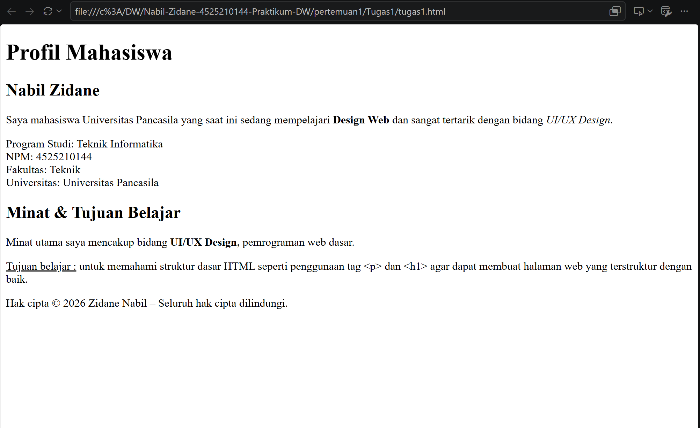

# TUGAS 1 – Profil Mahasiswa

## Deskripsi
Halaman web profil mahasiswa dibuat menggunakan HTML dasar untuk menampilkan informasi diri, akademik, minat, dan tujuan belajar.

## Implementasi
HTML menggunakan tag heading (`h1`, `h2`) untuk mengatur hierarki judul, serta `p`, `strong`, `em`, `u`, dan `br` untuk menyusun dan memformat teks. HTML entity seperti `&amp;`, `&copy;`, dan `&ndash;` digunakan untuk menampilkan karakter khusus dengan benar.

## ss run
