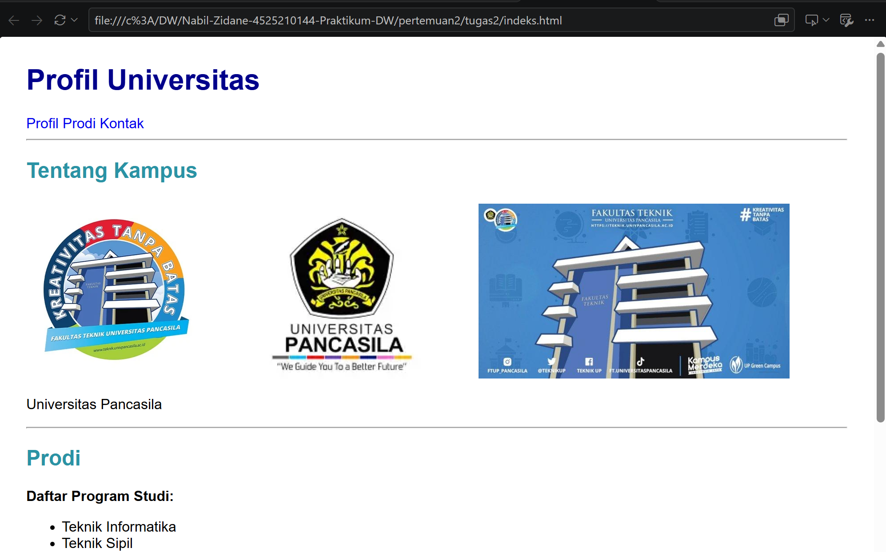
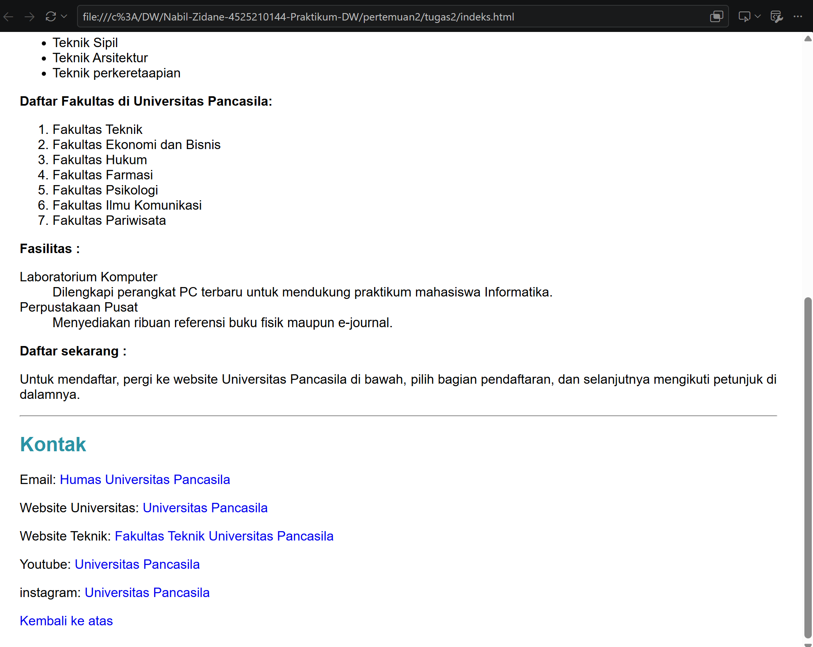

# Tugas2-Profil Universitas Pancasila

## Deskripsi
Proyek ini merupakan halaman profil statis Universitas Pancasila yang dibuat menggunakan HTML dan CSS. Halaman ini menyajikan informasi kampus, program studi, fakultas, fasilitas, alur pendaftaran, serta kontak dan media sosial.

## Struktur Halaman
**Beranda:** Judul halaman dan navigasi.
**Profil:** Informasi Universitas Pancasila beserta gambar logo dan gedung Fakultas Teknik.
**Program Studi:** Daftar program studi menggunakan unordered list, daftar fakultas menggunakan ordered list, serta fasilitas menggunakan description list.
**Pendaftaran:** Informasi singkat mengenai langkah pendaftaran mahasiswa.
**Kontak:** Email, website universitas, website fakultas, YouTube, Instagram, dan tautan kembali ke atas.

## Implementasi HTML
Elemen HTML yang digunakan meliputi heading, paragraf, gambar dengan atribut `alt`, tautan internal, tautan eksternal, dan `mailto`. Tiga jenis list (`ul`, `ol`, dan `dl`) digunakan untuk menyusun informasi secara terstruktur. CSS diterapkan melalui file `css/style.css`.

## Kendala dan Solusi
Kendala yang dihadapi adalah menyusun konten secara terstruktur, menentukan jalur gambar, dan mengatur tautan agar sesuai dengan tujuan. Solusinya adalah menggunakan elemen HTML yang tepat, memastikan nama file dan jalur gambar sesuai, serta membedakan tautan internal, eksternal, dan email.

## ss run

